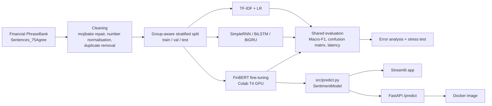

# Financial News Intelligence

**A comparative study of five NLP models for financial sentiment, from TF-IDF to a fine-tuned FinBERT, shipped as a Streamlit app and a Dockerised REST API.**

Given one sentence of financial news, the system says whether it is **positive, neutral or negative** for investors.

> "Operating profit rose to EUR 13.1 mn from EUR 8.7 mn." → **positive** (0.999)

---

## Results

All models were trained on the same split, tuned on validation only and scored **once** on a held-out test set (492 sentences). Latency is measured on the same laptop CPU, one sentence at a time.

| Model | Test Macro-F1 | Parameters | Median latency (CPU) |
|---|---|---|---|
| Always "neutral" (baseline) | 0.255 | 0 | – |
| SimpleRNN | 0.578 | 501K | 5.0 ms* |
| BiGRU | 0.741 | 543K | 5.9 ms* |
| BiLSTM | 0.745 | 559K | 5.8 ms* |
| TF-IDF + Logistic Regression | 0.806 | 20K | **0.5 ms** |
| **FinBERT (fine-tuned)** | **0.925** | 110M | 93.5 ms |

\*Compiled with `tf.function`. In eager mode, Keras overhead made the RNNs look 94–332 ms, slower than FinBERT. Checking that number is what caught the mistake.

**Why Macro-F1?** 62% of sentences are neutral, so a model that always says "neutral" gets 62% accuracy while being useless. Its Macro-F1 is 0.255.

## Key findings

1. **Pre-training wins.** FinBERT beats the best classical model by **+0.12 Macro-F1**, at about 5,500× the parameters and about 190× the latency.
2. **The simple baseline is hard to beat.** TF-IDF + Logistic Regression beats every RNN, and is the right choice when speed or cost matters more than the last 12 points.
3. **Gates matter, LSTM vs GRU doesn't.** A plain SimpleRNN overfits badly (0.578); adding gates gives +0.17. BiLSTM and BiGRU are within 0.004, which is noise.
4. **Every model fails on the same hard cases.** In a 10-sentence stress test, FinBERT scored only 5/10:
   - it ignores negation ("Operating profit did **not** rise" → positive)
   - it treats "loss narrowed" as negative
   - no model knows "net debt decreased" is good news.
5. **Of FinBERT's 28 test errors, 12 are debatable labels**, where the "gold" answer is arguable. Only 16 are clear model mistakes.
6. **News mood did not predict the market** (optional experiment). 436,564 headlines scored on GPU against next-day S&P 500 moves (NIFTY dataset), with a time-based split and look-ahead bias checked. Correlation was +0.03 (train) and −0.11 (test), and a classifier did no better than always predicting "flat". This is a reported null result.

## Architecture



## Data and preprocessing

- **Dataset:** [Financial PhraseBank](https://huggingface.co/datasets/takala/financial_phrasebank) (Malo et al., 2014), `Sentences_75Agree`: 3,453 sentences, at least 75% annotator agreement. Neutral 62.1%, positive 25.7%, negative 12.2%.
- **Mojibake repair:** 74 sentences had corrupted characters (`Sepp+ñl+ñ` → Seppälä). Repaired with code-generated rules and checked by eye.
- **Number normalisation:** fixed split decimals (`EUR10 .1 m`) and unit spellings (mn / mln / m → one form).
- **Leakage control:**
  - exact duplicates removed, leaving 3,440 rows
  - near-duplicate templates ("Operating profit rose to EUR X mn from EUR Y mn") kept entirely in one split
  - FinBERT starts from the *domain-pretrained* `yiyanghkust/finbert-pretrain`, **not** `ProsusAI/finbert`, which was already fine-tuned on this dataset.

## Models

| Model | Setup |
|---|---|
| TF-IDF + LR | TF-IDF features, logistic regression, no stop-word removal (it deletes "up", "down", "not") |
| SimpleRNN | Embedding 64 → SimpleRNN 64 → Dropout 0.3 |
| BiLSTM / BiGRU | Embedding → Bidirectional(LSTM/GRU 64), early stopping |
| FinBERT | `yiyanghkust/finbert-pretrain`, lr 2e-5, warmup, weight decay 0.01, class-weighted loss, fp16, early stopping on val Macro-F1. Best at epoch 3; 98 s on a T4 |

## Project structure

```
financial-news-intelligence/
├── data/               raw (read-only) and processed splits
├── notebooks/          one notebook per phase (EDA → models → comparison → error analysis → market test)
├── src/
│   ├── data_utils.py   loading, mojibake repair, normalize_numbers
│   ├── evaluate.py     shared evaluation used by every model
│   └── predict.py      SentimentModel: the one prediction path for app and API
├── app/app.py          Streamlit demo
├── api/main.py         FastAPI service
├── results/            metrics, comparison.csv, error analysis, figures
├── models/             saved models (not in git)
├── requirements.txt        training environment
├── requirements-api.txt    pinned serving dependencies
└── Dockerfile
```

## How to run

```bash
python -m venv .venv
.venv\Scripts\activate            # Windows  (source .venv/bin/activate on Mac/Linux)
pip install -r requirements.txt
```

The fine-tuned FinBERT (440 MB) is not in git. Place it in `models/finbert/`.

**Streamlit app** (compare FinBERT and TF-IDF side by side):
```bash
python -m streamlit run app/app.py --server.fileWatcherType none
```

**REST API:**
```bash
python -m uvicorn api.main:app --port 8000
# open http://127.0.0.1:8000/docs
```

```bash
curl -X POST http://127.0.0.1:8000/predict \
  -H "Content-Type: application/json" \
  -d '{"texts": ["Operating profit rose to EUR 13.1 mn from EUR 8.7 mn ."]}'
```
```json
{"model_version": "finbert-v1", "latency_ms": 501.7,
 "results": [{"label": "positive", "confidence": 0.9991,
              "probabilities": {"negative": 0.0006, "neutral": 0.0003, "positive": 0.9991}}]}
```

**Docker:**
```bash
docker build -t fin-sentiment-api .
docker run -p 8000:8000 fin-sentiment-api
```

The API validates input (1–32 texts, otherwise a 422 error), exposes `/health` for monitoring, and returns `model_version` with every prediction.

## Limitations

- **Negation and implicit sentiment:** see finding 4. Do not trust a single prediction on sentences with "not", "narrowed" or debt figures.
- **Domain:** short, mostly Finnish company news from the 2000s. Expect lower accuracy on tweets, earnings calls or very recent jargon.
- **Sentence level only:** no document context or company entity linking.
- **Not investment advice.** Finding 6 shows sentiment alone did not predict next-day market moves.

## What I'd do next

- Add negation and "bad word, good news" examples (data augmentation), and track the stress-test score as a metric.
- Distil FinBERT into a smaller model to close the latency gap with TF-IDF.
- Add experiment tracking (MLflow) and input-drift monitoring for the API.
